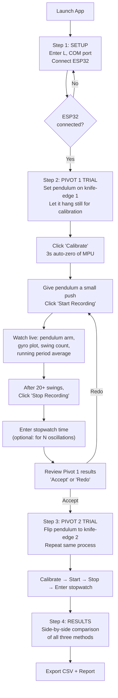
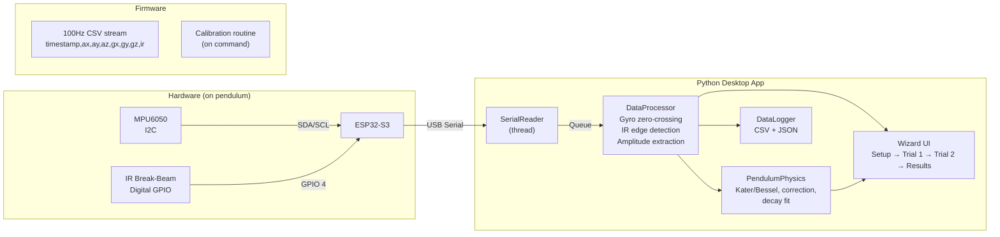

# Kater's Pendulum — MPU6050 + IR Sensor Experiment System (v2)

## Goal

Build a **guided experiment system** for a Kater's (reversible) pendulum that:

1. Automates data collection using an **MPU6050** (gyro + accelerometer) and an **IR break-beam sensor** — both wired to the same ESP32-S3
2. Walks a novice user through the full experiment step-by-step (wizard UI)
3. Produces **three independent period measurements** for comparison:
   - **Gyro zero-crossing** at swing extremes (MPU6050)
   - **IR break-beam** at center crossing (hardware)
   - **Manual stopwatch** (user enters their own timing)
4. Computes $g$, applies amplitude correction, fits the decay curve
5. Generates a **comparison report**: automated vs manual vs accepted $g$, showing how much the automation improves accuracy

### What This Project Proves

> A first-year physics student can get a more accurate measurement of $g$ by using a \$3 IMU + IR sensor with software automation than by using a stopwatch and counting oscillations by eye. The software eliminates human reaction-time error, detects amplitude for correction, and measures every single swing instead of averaging over many.

---

## The Experiment Protocol (What the User Actually Does)

This is the step-by-step experience from the user's perspective:



### Detailed Step Descriptions

#### Step 1 — Setup
The user sees a clean setup screen:
- **COM Port** dropdown (auto-detects available ports)
- **Knife-edge distance $L$** input field (meters, e.g. `0.994`)
- **Accepted $g$** input (defaults to `9.80665`, user can enter local value)
- **"Connect"** button → attempts serial connection, shows ✅ or ❌
- Once connected, a small live preview shows raw MPU numbers to confirm wiring works

#### Step 2 — Pivot 1 Trial
The user has placed the pendulum on knife-edge 1, hanging at rest.
- **"Calibrate"** button → tells ESP32 to run `calcOffsets()`, records $a_{z,\text{rest}}$ for 3 seconds. Status bar shows "Calibrating… keep still" → "✅ Calibration done."
- **"Start Recording"** button → the user pushes the pendulum and clicks this. From this moment:
  - The live 2D pendulum arm starts moving
  - The gyro plot scrolls with zero-crossing markers (red dots)
  - Each IR center-crossing is marked (green dots on the plot)
  - A counter shows: `Swings: 0 → 1 → 2 → ...`
  - Running averages update: $T_{\text{gyro}}$, $T_{\text{IR}}$, $\theta_0$
  - The decay scatter plot builds up in real time
- **"Stop Recording"** button → freezes everything. Shows a summary card:
  - Number of complete oscillations
  - $T_1$ (gyro method) ± std dev
  - $T_1$ (IR method) ± std dev
  - Amplitude range: $\theta_{\text{start}}$ → $\theta_{\text{end}}$
  - Corrected $T_1$
- **"Enter Stopwatch"** section: user types their manual measurement. Two fields:
  - "Number of oscillations timed:" (e.g., `20`)
  - "Total stopwatch time (s):" (e.g., `40.12`)
  - Computed: $T_1^{\text{manual}} = 40.12 / 20 = 2.006$ s
- **"Accept"** or **"Redo Trial"** buttons

#### Step 3 — Pivot 2 Trial
Identical UI to Step 2, but for the flipped pendulum. Produces $T_2$ by all three methods.

> [!NOTE]
> If $T_1$ and $T_2$ are very close (within 0.1%), the app uses the simple formula $g = 4\pi^2 L / T^2$ with $T = (T_1 + T_2)/2$. Otherwise it uses Bessel's formula. The user is told which formula was used and why.

#### Step 4 — Results & Comparison
A dashboard showing everything:

| Metric | Gyro (MPU) | IR Sensor | Manual Stopwatch |
|--------|-----------|-----------|-----------------|
| $T_1$ (s) | 2.00128 ± 0.00003 | 2.00131 ± 0.00005 | 2.006 |
| $T_2$ (s) | 2.00135 ± 0.00004 | 2.00129 ± 0.00004 | 2.009 |
| $T_0$ (corrected) | 2.00098 | 2.00101 | — |
| $g$ (m/s²) | 9.8052 | 9.8051 | 9.7812 |
| Error vs accepted | 0.015% | 0.016% | 0.26% |

Plus:
- Decay curve (amplitude vs swing number) with exponential fit
- Quality factor $Q$
- Logarithmic decrement $\delta$
- Export buttons: **CSV** (raw data) and **JSON** (session summary)

---

## User Review Required

> [!IMPORTANT]
> **IR sensor GPIO pin**: I'll default to **GPIO 4** for the IR sensor input. The ESP32-S3 can use any GPIO — let me know if you have a different pin in mind.

> [!IMPORTANT]
> **Bessel's formula needs $h_1 - h_2$**: When $T_1 \neq T_2$ exactly, Bessel's formula requires the asymmetry $(h_1 - h_2)$, which comes from balancing the pendulum to find the center of mass. The app will ask for this during Setup. If you don't want to measure it, we can skip Bessel's and just average $T_1, T_2$ with the simple formula.

> [!CAUTION]
> **Amplitude correction sign (confirmed from v1)**: The corrected period is:
> $$T_0 \approx T_{\text{measured}} \times \left(1 - \frac{\theta_0^2}{16}\right)$$
> This **reduces** the period (removes the finite-amplitude lengthening). The plan implements this correctly.

---

## Architecture Overview



### Serial Protocol

The ESP32 streams one CSV line per sample at 100 Hz:

```
timestamp_ms,ax,ay,az,gx,gy,gz,ir
```

- `timestamp_ms`: `millis()` value (uint32)
- `ax,ay,az`: accelerometer in g (float, 4 decimal places)
- `gx,gy,gz`: gyroscope in °/s (float, 2 decimal places)
- `ir`: IR sensor state, `0` or `1` (digital read)

**Special command lines** (Python → ESP32):
- `CMD:CAL` → triggers recalibration (`mpu.calcOffsets()`)
- `CMD:PING` → ESP32 responds `# PONG`

**Metadata lines** (ESP32 → Python, prefixed with `#`):
- `# STREAM_START` — calibration done, data lines follow
- `# CAL_DONE` — recalibration complete
- `# PONG` — response to ping

---

## Project Structure

```
physicsproject/
├── platformio.ini
├── src/
│   └── main.cpp                   # ESP32 firmware
├── include/
│   └── config.h                   # Pin assignments, sample rate
├── python/
│   ├── requirements.txt
│   ├── main.py                    # Entry point
│   ├── serial_reader.py           # Threaded serial reader + command sender
│   ├── data_processor.py          # Zero-crossing, IR edge, amplitude
│   ├── pendulum_physics.py        # Kater's, Bessel's, correction, decay
│   ├── data_logger.py             # CSV + JSON session export
│   ├── widgets/
│   │   ├── __init__.py
│   │   ├── pendulum_widget.py     # 2D pendulum arm + arrow visualization
│   │   ├── setup_page.py          # Step 1: connection & parameters
│   │   ├── trial_page.py          # Steps 2 & 3: recording UI
│   │   └── results_page.py        # Step 4: comparison dashboard
│   └── experiment.py              # Experiment session state machine
└── README.md
```

---

## Proposed Changes

### ESP32 Firmware

---

#### [NEW] `platformio.ini`

```ini
[env:esp32-s3-devkitc-1]
platform = espressif32
board = esp32-s3-devkitc-1
framework = arduino
monitor_speed = 115200

build_flags = 
    -D ARDUINO_USB_CDC_ON_BOOT=1
    -D ARDUINO_USB_MODE=1

lib_deps =
    rfetick/MPU6050_light @ ^1.1.0
```

---

#### [NEW] `include/config.h`

```cpp
#pragma once

// ── I2C (MPU6050) ─────────────────────────
#define I2C_SDA       8
#define I2C_SCL       9

// ── IR Break-Beam Sensor ──────────────────
#define IR_SENSOR_PIN 4    // Digital input, HIGH = beam broken (pendulum crossing)

// ── Streaming ─────────────────────────────
#define STREAM_INTERVAL_MS 10   // 100 Hz
#define SERIAL_BAUD 115200

// ── MPU6050 Axis Mapping ──────────────────
// Sensor mounted flat on the rod:
//   Z-axis → along the rod (toward pivot)
//   X-axis → tangential to swing plane
// Swing-plane gyro: X-axis
```

---

#### [NEW] `src/main.cpp`

Key changes from v1:
- Reads IR sensor digital pin and sends it as 8th CSV column
- Listens for `CMD:CAL` to recalibrate mid-session (needed when flipping the pendulum)
- Listens for `CMD:PING` for connection verification

```cpp
#include <Arduino.h>
#include <Wire.h>
#include <MPU6050_light.h>
#include "config.h"

MPU6050 mpu(Wire);
unsigned long lastStreamTime = 0;
bool streaming = false;

void runCalibration() {
    Serial.println("# CALIBRATING");
    delay(500);
    mpu.calcOffsets(true, true);
    Serial.println("# CAL_DONE");
}

void handleCommand(const String& cmd) {
    if (cmd == "CMD:CAL") {
        runCalibration();
    } else if (cmd == "CMD:PING") {
        Serial.println("# PONG");
    }
}

void setup() {
    Serial.begin(SERIAL_BAUD);
    
    // IR sensor pin
    pinMode(IR_SENSOR_PIN, INPUT_PULLUP);

    // I2C + MPU6050
    Wire.begin(I2C_SDA, I2C_SCL);
    Wire.setClock(400000);

    byte status = mpu.begin();
    Serial.print("# MPU6050 status: ");
    Serial.println(status);
    if (status != 0) {
        Serial.println("# ERROR: MPU6050 not found!");
        while (1) delay(1000);
    }

    // Initial calibration — pendulum must be still
    Serial.println("# Initial calibration... keep pendulum still");
    runCalibration();

    // Column header
    Serial.println("# columns: timestamp_ms,ax,ay,az,gx,gy,gz,ir");
    Serial.println("# units: ms, g, g, g, deg/s, deg/s, deg/s, 0/1");
    Serial.println("# STREAM_START");
    streaming = true;
}

void loop() {
    // Check for incoming commands from Python
    if (Serial.available()) {
        String line = Serial.readStringUntil('\n');
        line.trim();
        if (line.startsWith("CMD:")) {
            handleCommand(line);
        }
    }

    mpu.update();

    if (!streaming) return;

    unsigned long now = millis();
    if (now - lastStreamTime >= STREAM_INTERVAL_MS) {
        lastStreamTime = now;
        
        int irState = digitalRead(IR_SENSOR_PIN);

        // CSV: timestamp, ax, ay, az, gx, gy, gz, ir
        Serial.printf("%lu,%.4f,%.4f,%.4f,%.2f,%.2f,%.2f,%d\n",
                      now,
                      mpu.getAccX(), mpu.getAccY(), mpu.getAccZ(),
                      mpu.getGyroX(), mpu.getGyroY(), mpu.getGyroZ(),
                      irState);
    }
}
```

---

### Python — Core Modules

---

#### [NEW] `python/requirements.txt`

```
pyserial>=3.5
pyqtgraph>=0.13
PyQt5>=5.15
numpy>=1.24
```

---

#### [NEW] `python/serial_reader.py`

Updated from v1: now parses 8 columns (includes IR), supports sending commands to ESP32, tracks rest-state calibration.

```python
"""Threaded serial reader for ESP32 CSV data (MPU6050 + IR sensor)."""

import threading
import queue
import serial
import numpy as np


class SerialReader(threading.Thread):
    """Reads 8-column CSV from ESP32, pushes parsed dicts to a queue.
    
    CSV: timestamp_ms, ax, ay, az, gx, gy, gz, ir
    Lines starting with '#' are metadata.
    """

    def __init__(self, port: str, baud: int = 115200):
        super().__init__(daemon=True)
        self.port = port
        self.baud = baud
        self.data_queue = queue.Queue(maxsize=10000)
        self.meta_queue = queue.Queue(maxsize=100)  # metadata/status messages
        self.running = True
        self.connected = False
        self.stream_started = False
        self._ser = None

        # Rest-state accelerometer (self-calibrating g reference)
        self.a_rest = None
        self._rest_samples = []
        self._collecting_rest = False

    def connect(self) -> bool:
        """Attempt to open the serial port. Returns True on success."""
        try:
            self._ser = serial.Serial(self.port, self.baud, timeout=1)
            self.connected = True
            return True
        except Exception as e:
            self.meta_queue.put(f"ERROR: {e}")
            return False

    def send_command(self, cmd: str):
        """Send a command string to the ESP32 (e.g., 'CMD:CAL')."""
        if self._ser and self._ser.is_open:
            self._ser.write(f"{cmd}\n".encode())

    def start_rest_calibration(self):
        """Begin collecting rest samples for a_rest measurement."""
        self._rest_samples = []
        self._collecting_rest = True
        self.a_rest = None

    def run(self):
        if not self._ser:
            if not self.connect():
                return

        while self.running:
            try:
                raw = self._ser.readline()
                if not raw:
                    continue
                line = raw.decode('utf-8', errors='ignore').strip()
                if not line:
                    continue

                # Metadata lines
                if line.startswith('#'):
                    self.meta_queue.put(line)
                    if 'STREAM_START' in line:
                        self.stream_started = True
                    if 'CAL_DONE' in line:
                        self.meta_queue.put('CAL_DONE')
                    continue

                if not self.stream_started:
                    continue

                # Parse CSV: timestamp, ax, ay, az, gx, gy, gz, ir
                parts = line.split(',')
                if len(parts) != 8:
                    continue

                vals = [float(x) for x in parts]
                sample = {
                    't': vals[0] / 1000.0,   # seconds
                    'ax': vals[1], 'ay': vals[2], 'az': vals[3],
                    'gx': vals[4], 'gy': vals[5], 'gz': vals[6],
                    'ir': int(vals[7]),
                }

                # Collect rest-state samples for g reference
                if self._collecting_rest:
                    self._rest_samples.append(sample['az'])
                    if len(self._rest_samples) >= 100:
                        self.a_rest = float(np.mean(self._rest_samples))
                        self._collecting_rest = False
                        self.meta_queue.put(
                            f"REST_CAL: a_rest = {self.a_rest:.4f} g"
                        )

                self.data_queue.put(sample)

            except (ValueError, serial.SerialException):
                continue
            except Exception as e:
                self.meta_queue.put(f"ERROR: {e}")
                continue

        if self._ser:
            self._ser.close()

    def stop(self):
        self.running = False
```

---

#### [NEW] `python/data_processor.py`

Now includes **both** gyro zero-crossing and IR edge detection for period measurement. The two methods run in parallel on the same data stream.

```python
"""Real-time pendulum swing analysis: gyro zero-crossing + IR edge detection.

Produces SwingEvents (reversals) and PeriodMeasurements from two
independent methods that can be compared against each other.
"""

import numpy as np
from dataclasses import dataclass, field
from typing import List, Optional, Callable
from enum import Enum


class Method(Enum):
    GYRO = "gyro"       # Zero-crossing at extremes
    IR = "ir"           # Break-beam at center


@dataclass
class SwingEvent:
    """A detected swing reversal (from gyro zero-crossing)."""
    timestamp: float
    amplitude_rad: float
    amplitude_deg: float
    direction: str            # 'left' or 'right'
    raw_accel_rod: float


@dataclass
class IRCrossing:
    """An IR beam crossing event (pendulum passing center)."""
    timestamp: float
    direction: str            # 'entering' or 'leaving' based on IR transition


@dataclass
class PeriodMeasurement:
    """A measured full period from either method."""
    T_measured: float
    T_corrected: float        # amplitude-corrected (gyro only; IR copies T_measured)
    method: Method
    amplitude_avg: float      # average amplitude during this cycle (rad)
    swing_number: int


class DataProcessor:
    """Dual-method period detection from streaming IMU + IR data.
    
    Method 1 — GYRO: Detects swing reversals via gyro zero-crossing.
        At each reversal, reads accelerometer to get amplitude.
        Period = time between same-direction reversals.
    
    Method 2 — IR: Detects center crossings from IR pin transitions.
        Two consecutive same-direction crossings = one full period.
    """

    def __init__(self, a_rest: float = 1.0,
                 gyro_axis: str = 'gx',
                 accel_rod_axis: str = 'az',
                 on_swing: Optional[Callable] = None,
                 on_period: Optional[Callable] = None,
                 on_ir_crossing: Optional[Callable] = None):
        self.a_rest = a_rest
        self.gyro_axis = gyro_axis
        self.accel_rod_axis = accel_rod_axis
        self.on_swing = on_swing
        self.on_period = on_period
        self.on_ir_crossing = on_ir_crossing

        # ── Gyro zero-crossing state ─────────────────
        self._prev_sample = None
        self.swings: List[SwingEvent] = []
        self._last_pos_crossing: Optional[SwingEvent] = None
        self._last_neg_crossing: Optional[SwingEvent] = None

        # ── IR edge detection state ──────────────────
        self._prev_ir = None
        self.ir_crossings: List[IRCrossing] = []
        self._ir_rising_edges: List[float] = []   # timestamps of 0→1
        self._ir_falling_edges: List[float] = []  # timestamps of 1→0

        # ── Period results (both methods) ────────────
        self.periods_gyro: List[PeriodMeasurement] = []
        self.periods_ir: List[PeriodMeasurement] = []

        # ── Recording control ────────────────────────
        self.recording = False
        self._swing_counter_gyro = 0
        self._swing_counter_ir = 0

    def start_recording(self):
        """Begin a new recording trial. Resets all state."""
        self.swings.clear()
        self.ir_crossings.clear()
        self.periods_gyro.clear()
        self.periods_ir.clear()
        self._prev_sample = None
        self._prev_ir = None
        self._last_pos_crossing = None
        self._last_neg_crossing = None
        self._ir_rising_edges.clear()
        self._ir_falling_edges.clear()
        self._swing_counter_gyro = 0
        self._swing_counter_ir = 0
        self.recording = True

    def stop_recording(self):
        """Stop recording. Data remains accessible for results."""
        self.recording = False

    def process_sample(self, sample: dict):
        """Process one IMU+IR sample. Must be called for every sample."""
        if not self.recording:
            return

        self._detect_gyro_crossing(sample)
        self._detect_ir_edge(sample)
        self._prev_sample = sample

    # ── Gyro zero-crossing (swing reversals) ─────────────────

    def _detect_gyro_crossing(self, sample: dict):
        if self._prev_sample is None:
            return

        g_prev = self._prev_sample[self.gyro_axis]
        g_curr = sample[self.gyro_axis]

        if g_prev * g_curr > 0:
            return  # no sign change
        if g_prev == 0 and g_curr == 0:
            return

        # Interpolate zero-crossing time
        t_prev = self._prev_sample['t']
        t_curr = sample['t']
        denom = g_curr - g_prev
        if abs(denom) > 1e-6:
            t_zero = t_prev - g_prev * (t_curr - t_prev) / denom
        else:
            t_zero = (t_prev + t_curr) / 2.0

        # Interpolate accel at crossing
        a_prev = self._prev_sample[self.accel_rod_axis]
        a_curr = sample[self.accel_rod_axis]
        frac = (t_zero - t_prev) / max(t_curr - t_prev, 1e-6)
        a_cross = a_prev + frac * (a_curr - a_prev)

        # Amplitude
        ratio = np.clip(a_cross / self.a_rest, -1.0, 1.0)
        theta = np.arccos(ratio)

        direction = 'right' if g_prev > 0 else 'left'

        swing = SwingEvent(
            timestamp=t_zero,
            amplitude_rad=theta,
            amplitude_deg=np.degrees(theta),
            direction=direction,
            raw_accel_rod=a_cross,
        )
        self.swings.append(swing)

        if self.on_swing:
            self.on_swing(swing)

        # Period from same-direction reversals
        if direction == 'right':
            if self._last_pos_crossing is not None:
                T = t_zero - self._last_pos_crossing.timestamp
                if T > 0.1:
                    self._record_gyro_period(T, self._last_pos_crossing, swing)
            self._last_pos_crossing = swing
        else:
            if self._last_neg_crossing is not None:
                T = t_zero - self._last_neg_crossing.timestamp
                if T > 0.1:
                    self._record_gyro_period(T, self._last_neg_crossing, swing)
            self._last_neg_crossing = swing

    def _record_gyro_period(self, T_meas, s1: SwingEvent, s2: SwingEvent):
        theta_avg = (s1.amplitude_rad + s2.amplitude_rad) / 2.0
        T_corr = T_meas * (1.0 - theta_avg**2 / 16.0)

        p = PeriodMeasurement(
            T_measured=T_meas,
            T_corrected=T_corr,
            method=Method.GYRO,
            amplitude_avg=theta_avg,
            swing_number=self._swing_counter_gyro,
        )
        self.periods_gyro.append(p)
        self._swing_counter_gyro += 1

        if self.on_period:
            self.on_period(p)

    # ── IR break-beam edge detection ─────────────────────────

    def _detect_ir_edge(self, sample: dict):
        ir_curr = sample['ir']
        if self._prev_ir is None:
            self._prev_ir = ir_curr
            return

        if ir_curr == self._prev_ir:
            self._prev_ir = ir_curr
            return

        # Edge detected
        t = sample['t']
        direction = 'entering' if ir_curr == 1 else 'leaving'

        crossing = IRCrossing(timestamp=t, direction=direction)
        self.ir_crossings.append(crossing)

        if self.on_ir_crossing:
            self.on_ir_crossing(crossing)

        # Track edges by type for period calculation
        if ir_curr == 1:  # rising edge
            self._ir_rising_edges.append(t)
            if len(self._ir_rising_edges) >= 2:
                # Period = time between consecutive rising edges
                # But: two rising edges = pendulum went right-center-left-center-right
                #      That's one FULL oscillation if the beam is at center
                # Actually: center crossing happens twice per period (once each way)
                # Rising edge → pendulum enters beam going one way
                # Next rising edge → enters beam going same way = 1 full period
                T = self._ir_rising_edges[-1] - self._ir_rising_edges[-2]
                if T > 0.1:
                    # Get average amplitude from nearest gyro swings
                    amp = self._get_nearest_amplitude(t)
                    T_corr = T * (1.0 - amp**2 / 16.0) if amp > 0 else T

                    p = PeriodMeasurement(
                        T_measured=T,
                        T_corrected=T_corr,
                        method=Method.IR,
                        amplitude_avg=amp,
                        swing_number=self._swing_counter_ir,
                    )
                    self.periods_ir.append(p)
                    self._swing_counter_ir += 1

                    if self.on_period:
                        self.on_period(p)

        self._prev_ir = ir_curr

    def _get_nearest_amplitude(self, t: float) -> float:
        """Get amplitude from the nearest gyro swing event."""
        if not self.swings:
            return 0.0
        # Find swing closest in time
        min_dt = float('inf')
        best = self.swings[-1]
        for s in reversed(self.swings[-10:]):
            dt = abs(s.timestamp - t)
            if dt < min_dt:
                min_dt = dt
                best = s
        return best.amplitude_rad

    # ── Aggregate getters ────────────────────────────────────

    def get_mean_period(self, method: Method, last_n: int = 10):
        """Return (mean, std) of the last N corrected periods for a method."""
        periods = self.periods_gyro if method == Method.GYRO else self.periods_ir
        if not periods:
            return None, None
        recent = periods[-last_n:]
        T_vals = np.array([p.T_corrected for p in recent])
        return float(np.mean(T_vals)), float(np.std(T_vals))

    def get_all_periods(self, method: Method):
        """Return array of all corrected periods for a method."""
        periods = self.periods_gyro if method == Method.GYRO else self.periods_ir
        if not periods:
            return np.array([])
        return np.array([p.T_corrected for p in periods])

    def get_decay_data(self):
        """Return (swing_numbers, amplitudes_deg) for the decay plot."""
        if not self.swings:
            return np.array([]), np.array([])
        return (np.arange(len(self.swings)),
                np.array([s.amplitude_deg for s in self.swings]))

    def get_oscillation_count(self):
        """Number of complete oscillations detected (gyro method)."""
        return len(self.periods_gyro)
```

---

#### [NEW] `python/pendulum_physics.py`

Same as v1 but adds Bessel's formula. Clean, testable.

```python
"""Kater's pendulum physics: g calculation, amplitude correction, decay fit."""

import numpy as np
from typing import Tuple


def katers_g_ideal(L: float, T: float) -> float:
    """g = 4π²L / T² — equal-period case."""
    return 4.0 * np.pi**2 * L / T**2


def katers_g_bessel(T1: float, T2: float, L: float,
                    h1_minus_h2: float) -> float:
    """Bessel's formula for unequal periods.
    
    g = 8π² / [ (T₁² + T₂²)/L + (T₁² - T₂²)/(h₁ - h₂) ]
    """
    num = 8.0 * np.pi**2
    den = (T1**2 + T2**2) / L + (T1**2 - T2**2) / h1_minus_h2
    return num / den


def compute_g(T1: float, T2: float, L: float,
              h1_minus_h2: float = None,
              threshold: float = 0.001) -> Tuple[float, str]:
    """Smart g calculation: uses ideal if T₁≈T₂, Bessel's otherwise.
    
    Returns (g_value, formula_used_string).
    """
    rel_diff = abs(T1 - T2) / ((T1 + T2) / 2.0)

    if rel_diff < threshold or h1_minus_h2 is None:
        T_avg = (T1 + T2) / 2.0
        g = katers_g_ideal(L, T_avg)
        return g, f"Ideal (T₁≈T₂, rel diff = {rel_diff:.4%})"
    else:
        g = katers_g_bessel(T1, T2, L, h1_minus_h2)
        return g, f"Bessel's (rel diff = {rel_diff:.4%})"


def amplitude_correction(T_measured: float, theta0_rad: float) -> float:
    """T₀ ≈ T_measured × (1 − θ₀²/16)."""
    return T_measured * (1.0 - theta0_rad**2 / 16.0)


def fit_decay(swing_numbers: np.ndarray,
              amplitudes: np.ndarray) -> Tuple[float, float, float]:
    """Fit θ(n) = θ₀·exp(−γn). Returns (θ₀, γ, Q)."""
    mask = amplitudes > 0
    n, a = swing_numbers[mask], amplitudes[mask]
    if len(n) < 2:
        return 0.0, 0.0, float('inf')
    log_a = np.log(a)
    slope, intercept = np.polyfit(n, log_a, 1)
    gamma = -slope
    theta0 = np.exp(intercept)
    Q = np.pi / gamma if gamma > 0 else float('inf')
    return theta0, gamma, Q


def logarithmic_decrement(theta_start: float, theta_end: float,
                          N: int) -> float:
    """δ = (1/N) × ln(θ_start / θ_end)."""
    if theta_end <= 0 or N <= 0:
        return 0.0
    return (1.0 / N) * np.log(theta_start / theta_end)
```

---

#### [NEW] `python/data_logger.py`

Saves raw data to CSV and experiment sessions to JSON.

```python
"""Data logging: raw CSV export and JSON session summary."""

import csv
import json
import os
from datetime import datetime
from typing import List, Dict, Any


class DataLogger:
    """Logs raw IMU data to CSV and experiment results to JSON."""

    def __init__(self, output_dir: str = "data"):
        self.output_dir = output_dir
        os.makedirs(output_dir, exist_ok=True)
        self._csv_file = None
        self._csv_writer = None
        self._session_id = datetime.now().strftime("%Y%m%d_%H%M%S")

    def start_csv(self, trial_name: str):
        """Open a CSV file for raw data logging."""
        path = os.path.join(self.output_dir,
                            f"{self._session_id}_{trial_name}.csv")
        self._csv_file = open(path, 'w', newline='')
        self._csv_writer = csv.writer(self._csv_file)
        self._csv_writer.writerow(
            ['t', 'ax', 'ay', 'az', 'gx', 'gy', 'gz', 'ir'])
        return path

    def write_sample(self, sample: dict):
        """Write one sample to the open CSV."""
        if self._csv_writer:
            self._csv_writer.writerow([
                f"{sample['t']:.4f}",
                f"{sample['ax']:.4f}", f"{sample['ay']:.4f}",
                f"{sample['az']:.4f}",
                f"{sample['gx']:.2f}", f"{sample['gy']:.2f}",
                f"{sample['gz']:.2f}",
                sample['ir']
            ])

    def stop_csv(self):
        """Close the CSV file."""
        if self._csv_file:
            self._csv_file.close()
            self._csv_file = None
            self._csv_writer = None

    def save_session(self, results: Dict[str, Any]):
        """Save complete session results to JSON."""
        path = os.path.join(self.output_dir,
                            f"{self._session_id}_results.json")
        results['session_id'] = self._session_id
        results['timestamp'] = datetime.now().isoformat()
        with open(path, 'w') as f:
            json.dump(results, f, indent=2, default=str)
        return path
```

---

#### [NEW] `python/experiment.py`

State machine that manages the experiment flow across trials.

```python
"""Experiment session state machine.

Tracks the overall experiment state: which trial we're on,
what data we've collected, and computes final results.
"""

from dataclasses import dataclass, field
from typing import Optional, Dict, Any, List
from enum import Enum
import numpy as np

from data_processor import DataProcessor, Method
from pendulum_physics import compute_g, fit_decay, logarithmic_decrement


class ExperimentState(Enum):
    SETUP = "setup"
    PIVOT1_READY = "pivot1_ready"
    PIVOT1_CALIBRATING = "pivot1_calibrating"
    PIVOT1_RECORDING = "pivot1_recording"
    PIVOT1_DONE = "pivot1_done"
    PIVOT2_READY = "pivot2_ready"
    PIVOT2_CALIBRATING = "pivot2_calibrating"
    PIVOT2_RECORDING = "pivot2_recording"
    PIVOT2_DONE = "pivot2_done"
    RESULTS = "results"


@dataclass
class TrialResult:
    """Results from one pivot trial."""
    pivot_name: str             # "Pivot 1" or "Pivot 2"
    
    # Gyro method
    T_gyro_mean: float = 0.0
    T_gyro_std: float = 0.0
    T_gyro_corrected: float = 0.0
    n_oscillations_gyro: int = 0
    
    # IR method
    T_ir_mean: float = 0.0
    T_ir_std: float = 0.0
    T_ir_corrected: float = 0.0
    n_oscillations_ir: int = 0
    
    # Manual stopwatch
    T_manual: Optional[float] = None
    n_oscillations_manual: Optional[int] = None
    
    # Amplitude data
    amplitude_start_deg: float = 0.0
    amplitude_end_deg: float = 0.0
    amplitude_mean_deg: float = 0.0
    
    # Decay fit
    decay_theta0: float = 0.0
    decay_gamma: float = 0.0
    quality_factor: float = 0.0
    log_decrement: float = 0.0
    
    # Raw arrays for plotting
    decay_swing_numbers: List = field(default_factory=list)
    decay_amplitudes: List = field(default_factory=list)
    periods_gyro_all: List = field(default_factory=list)
    periods_ir_all: List = field(default_factory=list)


class Experiment:
    """Manages the full Kater's pendulum experiment session."""

    def __init__(self):
        self.state = ExperimentState.SETUP
        self.L: float = 1.0                    # knife-edge distance (m)
        self.h1_minus_h2: Optional[float] = None  # asymmetry (m)
        self.g_accepted: float = 9.80665       # reference g
        
        self.trial1: Optional[TrialResult] = None
        self.trial2: Optional[TrialResult] = None

    def finalize_trial(self, processor: DataProcessor,
                       pivot_name: str,
                       manual_T: float = None,
                       manual_N: int = None) -> TrialResult:
        """Extract results from a completed trial's DataProcessor."""
        result = TrialResult(pivot_name=pivot_name)

        # Gyro periods
        T_gyro_mean, T_gyro_std = processor.get_mean_period(Method.GYRO, last_n=999)
        if T_gyro_mean:
            result.T_gyro_mean = T_gyro_mean
            result.T_gyro_std = T_gyro_std
            result.T_gyro_corrected = T_gyro_mean  # already corrected per-swing
            result.n_oscillations_gyro = len(processor.periods_gyro)
            result.periods_gyro_all = [p.T_corrected for p in processor.periods_gyro]

        # IR periods
        T_ir_mean, T_ir_std = processor.get_mean_period(Method.IR, last_n=999)
        if T_ir_mean:
            result.T_ir_mean = T_ir_mean
            result.T_ir_std = T_ir_std
            result.T_ir_corrected = T_ir_mean
            result.n_oscillations_ir = len(processor.periods_ir)
            result.periods_ir_all = [p.T_corrected for p in processor.periods_ir]

        # Manual
        if manual_T and manual_N and manual_N > 0:
            result.T_manual = manual_T / manual_N
            result.n_oscillations_manual = manual_N

        # Amplitude / decay
        swing_n, swing_amp = processor.get_decay_data()
        if len(swing_n) > 0:
            result.amplitude_start_deg = float(swing_amp[0])
            result.amplitude_end_deg = float(swing_amp[-1])
            result.amplitude_mean_deg = float(np.mean(swing_amp))
            result.decay_swing_numbers = swing_n.tolist()
            result.decay_amplitudes = swing_amp.tolist()

            if len(swing_n) > 3:
                theta0, gamma, Q = fit_decay(swing_n, swing_amp)
                result.decay_theta0 = theta0
                result.decay_gamma = gamma
                result.quality_factor = Q
                result.log_decrement = gamma  # δ = γ per cycle

        return result

    def compute_results(self) -> Dict[str, Any]:
        """Compute final g values from both trials using all methods."""
        if not self.trial1 or not self.trial2:
            return {}

        results = {
            'L': self.L,
            'g_accepted': self.g_accepted,
            'trial1': self.trial1.__dict__,
            'trial2': self.trial2.__dict__,
        }

        # ── g from Gyro method ─────────────────────
        T1_g = self.trial1.T_gyro_corrected
        T2_g = self.trial2.T_gyro_corrected
        if T1_g > 0 and T2_g > 0:
            g_gyro, formula = compute_g(T1_g, T2_g, self.L, self.h1_minus_h2)
            results['g_gyro'] = g_gyro
            results['g_gyro_formula'] = formula
            results['g_gyro_error_pct'] = abs(g_gyro - self.g_accepted) / self.g_accepted * 100

        # ── g from IR method ──────────────────────
        T1_ir = self.trial1.T_ir_corrected
        T2_ir = self.trial2.T_ir_corrected
        if T1_ir > 0 and T2_ir > 0:
            g_ir, formula = compute_g(T1_ir, T2_ir, self.L, self.h1_minus_h2)
            results['g_ir'] = g_ir
            results['g_ir_formula'] = formula
            results['g_ir_error_pct'] = abs(g_ir - self.g_accepted) / self.g_accepted * 100

        # ── g from Manual method ──────────────────
        T1_m = self.trial1.T_manual
        T2_m = self.trial2.T_manual
        if T1_m and T2_m:
            g_manual, formula = compute_g(T1_m, T2_m, self.L, self.h1_minus_h2)
            results['g_manual'] = g_manual
            results['g_manual_formula'] = formula
            results['g_manual_error_pct'] = abs(g_manual - self.g_accepted) / self.g_accepted * 100

        return results
```

---

### Python — UI Widgets

---

#### [NEW] `python/widgets/__init__.py`
```python
"""UI widget modules for the Kater's Pendulum experiment."""
```

---

#### [NEW] `python/widgets/pendulum_widget.py`

The 2D live pendulum visualization (same concept as v1, extracted into its own widget).

```python
"""2D pendulum visualization: rod + bob + velocity arrow + trail."""

import numpy as np
import pyqtgraph as pg
from PyQt5 import QtCore

ROD_LEN = 0.8
TRAIL_LEN = 200


class PendulumWidget(pg.PlotWidget):
    """Animated pendulum arm with velocity arrow and motion trail."""

    def __init__(self, parent=None):
        super().__init__(parent)
        self.setAspectLocked(True)
        self.setXRange(-1.2, 1.2)
        self.setYRange(-1.4, 0.3)
        self.setTitle("Live Pendulum")
        self.hideAxis('bottom')
        self.hideAxis('left')
        self.setBackground('#1a1a2e')

        # Pivot
        self.plot([0], [0], pen=None, symbol='o', symbolSize=12, symbolBrush='w')

        # Rod + bob + arrow
        self.rod = self.plot([0, 0], [0, -ROD_LEN],
                             pen=pg.mkPen('#e0e0e0', width=3))
        self.bob = self.plot([0], [-ROD_LEN], pen=None, symbol='o',
                             symbolSize=18, symbolBrush='#ff6b6b')
        self.arrow_line = self.plot([0, 0], [-ROD_LEN, -ROD_LEN],
                                    pen=pg.mkPen('#00d2ff', width=3))
        self.arrowhead = self.plot([0], [-ROD_LEN], pen=None, symbol='t',
                                   symbolSize=14, symbolBrush='#00d2ff')

        # Trail
        self.trail_x, self.trail_y = [], []
        self.trail_curve = self.plot([], [], pen=pg.mkPen('#ff6b6b44', width=1))

        # Angle label
        self.angle_text = pg.TextItem("θ = 0.0°", color='w', anchor=(0, 0))
        self.angle_text.setPos(-1.1, 0.2)
        self.addItem(self.angle_text)

    def update_pendulum(self, theta_rad: float, gyro_rate: float):
        bx = ROD_LEN * np.sin(theta_rad)
        by = -ROD_LEN * np.cos(theta_rad)

        self.rod.setData([0, bx], [0, by])
        self.bob.setData([bx], [by])

        # Velocity arrow (tangential)
        scale = min(abs(gyro_rate) / 100.0, 0.4)
        tx, ty = np.cos(theta_rad), np.sin(theta_rad)
        sign = 1.0 if gyro_rate >= 0 else -1.0
        ax_e = bx + sign * tx * scale
        ay_e = by + sign * ty * scale
        self.arrow_line.setData([bx, ax_e], [by, ay_e])
        self.arrowhead.setData([ax_e], [ay_e])

        # Trail
        self.trail_x.append(bx)
        self.trail_y.append(by)
        if len(self.trail_x) > TRAIL_LEN:
            self.trail_x = self.trail_x[-TRAIL_LEN:]
            self.trail_y = self.trail_y[-TRAIL_LEN:]
        self.trail_curve.setData(self.trail_x, self.trail_y)

        self.angle_text.setText(f"θ = {np.degrees(theta_rad):.1f}°")

    def reset_trail(self):
        self.trail_x.clear()
        self.trail_y.clear()
        self.trail_curve.setData([], [])
```

---

#### [NEW] `python/widgets/setup_page.py`

Step 1 of the wizard. Connection, parameter entry, live preview.

```python
"""Setup page: COM port, parameters, connection test."""

from PyQt5 import QtWidgets, QtCore
import serial.tools.list_ports


class SetupPage(QtWidgets.QWidget):
    """Step 1: Connect to ESP32 and enter experiment parameters.
    
    Signals:
        connected(str, int)  — emitted with (port, baud) on successful connect
        params_ready(float, float, float)  — emitted with (L, h1_minus_h2, g_accepted)
    """
    connected = QtCore.pyqtSignal(str, int)
    proceed = QtCore.pyqtSignal()

    def __init__(self, parent=None):
        super().__init__(parent)
        layout = QtWidgets.QVBoxLayout(self)

        # Title
        title = QtWidgets.QLabel("Step 1 — Setup")
        title.setStyleSheet("font-size: 24px; font-weight: bold; color: #00d2ff;")
        layout.addWidget(title)

        # ── Connection group ────────────────────────
        conn_group = QtWidgets.QGroupBox("ESP32 Connection")
        conn_layout = QtWidgets.QHBoxLayout(conn_group)

        self.port_combo = QtWidgets.QComboBox()
        self.refresh_ports()
        conn_layout.addWidget(QtWidgets.QLabel("COM Port:"))
        conn_layout.addWidget(self.port_combo)

        refresh_btn = QtWidgets.QPushButton("↻ Refresh")
        refresh_btn.clicked.connect(self.refresh_ports)
        conn_layout.addWidget(refresh_btn)

        self.connect_btn = QtWidgets.QPushButton("Connect")
        conn_layout.addWidget(self.connect_btn)

        self.status_label = QtWidgets.QLabel("⬤ Not connected")
        self.status_label.setStyleSheet("color: #ff4444;")
        conn_layout.addWidget(self.status_label)

        layout.addWidget(conn_group)

        # ── Parameters group ────────────────────────
        params_group = QtWidgets.QGroupBox("Experiment Parameters")
        params_layout = QtWidgets.QFormLayout(params_group)

        self.L_input = QtWidgets.QDoubleSpinBox()
        self.L_input.setRange(0.01, 5.0)
        self.L_input.setDecimals(4)
        self.L_input.setValue(1.0)
        self.L_input.setSuffix(" m")
        params_layout.addRow("Knife-edge distance (L):", self.L_input)

        self.h_input = QtWidgets.QDoubleSpinBox()
        self.h_input.setRange(-2.0, 2.0)
        self.h_input.setDecimals(4)
        self.h_input.setValue(0.0)
        self.h_input.setSuffix(" m")
        self.h_input.setSpecialValueText("Not measured")
        params_layout.addRow("h₁ − h₂ (optional, for Bessel):", self.h_input)

        self.g_input = QtWidgets.QDoubleSpinBox()
        self.g_input.setRange(9.0, 10.0)
        self.g_input.setDecimals(5)
        self.g_input.setValue(9.80665)
        self.g_input.setSuffix(" m/s²")
        params_layout.addRow("Accepted g (reference):", self.g_input)

        layout.addWidget(params_group)

        # ── Instructions ────────────────────────────
        info = QtWidgets.QLabel(
            "1. Connect the ESP32 via USB\n"
            "2. Enter the distance between knife edges\n"
            "3. Click 'Connect' to verify communication\n"
            "4. Click 'Next →' to begin Pivot 1 trial"
        )
        info.setStyleSheet("color: #aaa; font-size: 13px; padding: 10px;")
        layout.addWidget(info)

        # ── Next button ─────────────────────────────
        self.next_btn = QtWidgets.QPushButton("Next → Begin Pivot 1 Trial")
        self.next_btn.setEnabled(False)
        self.next_btn.setStyleSheet(
            "font-size: 16px; padding: 12px; background: #00d2ff; color: #111;")
        self.next_btn.clicked.connect(self.proceed.emit)
        layout.addWidget(self.next_btn)

        layout.addStretch()

    def refresh_ports(self):
        self.port_combo.clear()
        ports = serial.tools.list_ports.comports()
        for p in ports:
            self.port_combo.addItem(f"{p.device} — {p.description}", p.device)

    def set_connected(self, success: bool):
        if success:
            self.status_label.setText("⬤ Connected")
            self.status_label.setStyleSheet("color: #00ff88;")
            self.next_btn.setEnabled(True)
        else:
            self.status_label.setText("⬤ Connection failed")
            self.status_label.setStyleSheet("color: #ff4444;")

    def get_port(self) -> str:
        return self.port_combo.currentData() or self.port_combo.currentText()

    def get_params(self) -> dict:
        h = self.h_input.value()
        return {
            'L': self.L_input.value(),
            'h1_minus_h2': h if h != 0 else None,
            'g_accepted': self.g_input.value(),
        }
```

---

#### [NEW] `python/widgets/trial_page.py`

Steps 2 & 3. Live recording UI — pendulum, gyro plot, counters, stopwatch entry. Reused for both pivots.

```python
"""Trial page: live recording for one pivot configuration.

Shows: pendulum widget, gyro plot (with zero-crossing + IR markers),
swing counter, running period averages, and post-trial stopwatch entry.
"""

import queue
import numpy as np
from PyQt5 import QtWidgets, QtCore
import pyqtgraph as pg

from widgets.pendulum_widget import PendulumWidget
from data_processor import DataProcessor, Method

WINDOW_SIZE = 500  # scrolling plot width in samples


class TrialPage(QtWidgets.QWidget):
    """Recording page for one pivot trial.
    
    Signals:
        trial_accepted(dict) — emitted when user accepts results.
                               Dict has 'processor', 'manual_T', 'manual_N'.
        trial_redo()         — emitted when user wants to redo.
    """
    trial_accepted = QtCore.pyqtSignal(dict)
    trial_redo = QtCore.pyqtSignal()

    def __init__(self, pivot_name: str = "Pivot 1", parent=None):
        super().__init__(parent)
        self.pivot_name = pivot_name
        self.processor: DataProcessor = None  # set externally before use

        layout = QtWidgets.QVBoxLayout(self)

        # Title
        title = QtWidgets.QLabel(f"Step — {pivot_name} Trial")
        title.setStyleSheet("font-size: 24px; font-weight: bold; color: #00d2ff;")
        layout.addWidget(title)

        # ── Top row: pendulum + plots ───────────────
        top = QtWidgets.QHBoxLayout()

        # Pendulum
        self.pendulum = PendulumWidget()
        self.pendulum.setMinimumSize(400, 400)
        top.addWidget(self.pendulum, stretch=1)

        # Right side: gyro plot + accel plot
        plots = pg.GraphicsLayoutWidget()
        self.gyro_plot = plots.addPlot(title="Gyro — swing axis (°/s)")
        self.gyro_plot.showGrid(x=True, y=True, alpha=0.3)
        self.gyro_curve = self.gyro_plot.plot(pen=pg.mkPen('#00d2ff', width=2))
        self.gyro_plot.addLine(y=0, pen=pg.mkPen('w', width=1, style=QtCore.Qt.DashLine))
        self.gyro_crossing_dots = pg.ScatterPlotItem(pen=None, brush='r', size=8)
        self.gyro_plot.addItem(self.gyro_crossing_dots)
        self.ir_crossing_dots = pg.ScatterPlotItem(pen=None, brush='#00ff88', size=10, symbol='d')
        self.gyro_plot.addItem(self.ir_crossing_dots)

        plots.nextRow()
        self.decay_plot = plots.addPlot(title="Amplitude Decay (°)")
        self.decay_plot.showGrid(x=True, y=True, alpha=0.3)
        self.decay_scatter = pg.ScatterPlotItem(pen=None, brush='#ff6b6b', size=5)
        self.decay_plot.addItem(self.decay_scatter)
        self.decay_fit = self.decay_plot.plot(pen=pg.mkPen('#00ff88', width=2, style=QtCore.Qt.DashLine))

        top.addWidget(plots, stretch=2)
        layout.addLayout(top)

        # ── Control bar ─────────────────────────────
        ctrl = QtWidgets.QHBoxLayout()

        self.cal_btn = QtWidgets.QPushButton("📐 Calibrate (keep still)")
        self.cal_btn.setStyleSheet("padding: 10px; font-size: 14px;")
        ctrl.addWidget(self.cal_btn)

        self.start_btn = QtWidgets.QPushButton("▶ Start Recording")
        self.start_btn.setStyleSheet("padding: 10px; font-size: 14px; background: #00cc66; color: #111;")
        self.start_btn.setEnabled(False)
        ctrl.addWidget(self.start_btn)

        self.stop_btn = QtWidgets.QPushButton("⏹ Stop Recording")
        self.stop_btn.setStyleSheet("padding: 10px; font-size: 14px; background: #ff4444; color: white;")
        self.stop_btn.setEnabled(False)
        ctrl.addWidget(self.stop_btn)

        layout.addLayout(ctrl)

        # ── Live stats bar ──────────────────────────
        stats = QtWidgets.QHBoxLayout()
        self.lbl_swings = self._stat_label("Swings: 0")
        self.lbl_T_gyro = self._stat_label("T (gyro): —")
        self.lbl_T_ir = self._stat_label("T (IR): —")
        self.lbl_theta = self._stat_label("θ₀: —")
        self.lbl_status = self._stat_label("Status: Ready")
        for lbl in [self.lbl_swings, self.lbl_T_gyro, self.lbl_T_ir,
                     self.lbl_theta, self.lbl_status]:
            stats.addWidget(lbl)
        layout.addLayout(stats)

        # ── Post-trial: stopwatch entry + accept/redo ──
        self.post_frame = QtWidgets.QGroupBox("Manual Stopwatch Comparison")
        self.post_frame.setVisible(False)
        post_layout = QtWidgets.QFormLayout(self.post_frame)

        self.sw_N = QtWidgets.QSpinBox()
        self.sw_N.setRange(1, 500)
        self.sw_N.setValue(20)
        post_layout.addRow("Oscillations timed:", self.sw_N)

        self.sw_time = QtWidgets.QDoubleSpinBox()
        self.sw_time.setRange(0, 9999)
        self.sw_time.setDecimals(2)
        self.sw_time.setSuffix(" s")
        post_layout.addRow("Stopwatch total time:", self.sw_time)

        self.sw_result = QtWidgets.QLabel("T = — s")
        post_layout.addRow("Manual T per oscillation:", self.sw_result)
        self.sw_time.valueChanged.connect(self._update_manual_T)
        self.sw_N.valueChanged.connect(self._update_manual_T)

        btn_row = QtWidgets.QHBoxLayout()
        self.accept_btn = QtWidgets.QPushButton("✅ Accept & Continue")
        self.accept_btn.setStyleSheet("padding: 10px; font-size: 14px; background: #00d2ff; color: #111;")
        self.redo_btn = QtWidgets.QPushButton("🔄 Redo Trial")
        self.redo_btn.setStyleSheet("padding: 10px; font-size: 14px;")
        btn_row.addWidget(self.accept_btn)
        btn_row.addWidget(self.redo_btn)
        post_layout.addRow(btn_row)

        layout.addWidget(self.post_frame)

        # ── Wire buttons ────────────────────────────
        self.start_btn.clicked.connect(self._on_start)
        self.stop_btn.clicked.connect(self._on_stop)
        self.accept_btn.clicked.connect(self._on_accept)
        self.redo_btn.clicked.connect(self._on_redo)

        # ── Internal state ──────────────────────────
        self.gyro_buf = np.zeros(WINDOW_SIZE)
        self._recording = False
        self._gyro_crossing_positions = []
        self._ir_crossing_positions = []
        self._sample_count = 0

    def _stat_label(self, text):
        lbl = QtWidgets.QLabel(text)
        lbl.setStyleSheet("font-size: 15px; font-weight: bold; color: #e0e0e0; padding: 4px 8px;")
        return lbl

    def set_calibrated(self):
        self.start_btn.setEnabled(True)
        self.lbl_status.setText("Status: Calibrated ✅")

    def _on_start(self):
        self._recording = True
        self.post_frame.setVisible(False)
        self.start_btn.setEnabled(False)
        self.stop_btn.setEnabled(True)
        self.cal_btn.setEnabled(False)
        self.pendulum.reset_trail()
        self.gyro_buf[:] = 0
        self._gyro_crossing_positions.clear()
        self._ir_crossing_positions.clear()
        self._sample_count = 0
        if self.processor:
            self.processor.start_recording()
        self.lbl_status.setText("Status: ● RECORDING")
        self.lbl_status.setStyleSheet(
            "font-size: 15px; font-weight: bold; color: #ff4444; padding: 4px 8px;")

    def _on_stop(self):
        self._recording = False
        self.stop_btn.setEnabled(False)
        self.cal_btn.setEnabled(True)
        if self.processor:
            self.processor.stop_recording()
        self.post_frame.setVisible(True)
        self.lbl_status.setText("Status: Recording stopped — enter stopwatch data")
        self.lbl_status.setStyleSheet(
            "font-size: 15px; font-weight: bold; color: #ffaa00; padding: 4px 8px;")

    def _update_manual_T(self):
        N = self.sw_N.value()
        t = self.sw_time.value()
        if N > 0 and t > 0:
            self.sw_result.setText(f"T = {t / N:.5f} s")

    def _on_accept(self):
        N = self.sw_N.value()
        t = self.sw_time.value()
        self.trial_accepted.emit({
            'processor': self.processor,
            'manual_T': t if t > 0 else None,
            'manual_N': N if t > 0 else None,
        })

    def _on_redo(self):
        self.start_btn.setEnabled(True)
        self.post_frame.setVisible(False)
        self.lbl_status.setText("Status: Ready to redo")
        self.trial_redo.emit()

    def process_and_draw(self, sample: dict):
        """Called from the main update loop with each new sample."""
        if not self._recording or not self.processor:
            return

        self.processor.process_sample(sample)
        self._sample_count += 1

        # Update pendulum angle
        theta = np.arctan2(sample['ax'], sample['az'])
        gyro = sample[self.processor.gyro_axis]
        self.pendulum.update_pendulum(theta, gyro)

        # Scrolling gyro buffer
        self.gyro_buf = np.roll(self.gyro_buf, -1)
        self.gyro_buf[-1] = gyro
        self.gyro_curve.setData(self.gyro_buf)

        # Track crossing positions for scatter markers
        n_swings_now = len(self.processor.swings)
        if n_swings_now > len(self._gyro_crossing_positions):
            self._gyro_crossing_positions.append(self._sample_count)
            # Remap to buffer coordinates
            positions = [WINDOW_SIZE - (self._sample_count - p)
                         for p in self._gyro_crossing_positions
                         if self._sample_count - p < WINDOW_SIZE]
            self.gyro_crossing_dots.setData(
                [p for p in positions if 0 <= p < WINDOW_SIZE],
                [0] * len([p for p in positions if 0 <= p < WINDOW_SIZE])
            )

        n_ir_now = len(self.processor.ir_crossings)
        if n_ir_now > len(self._ir_crossing_positions):
            self._ir_crossing_positions.append(self._sample_count)

        # Live stats
        self.lbl_swings.setText(f"Swings: {n_swings_now}")
        if self.processor.swings:
            self.lbl_theta.setText(
                f"θ₀: {self.processor.swings[-1].amplitude_deg:.1f}°")
        T_g, _ = self.processor.get_mean_period(Method.GYRO)
        if T_g:
            self.lbl_T_gyro.setText(f"T (gyro): {T_g:.5f} s")
        T_ir, _ = self.processor.get_mean_period(Method.IR)
        if T_ir:
            self.lbl_T_ir.setText(f"T (IR): {T_ir:.5f} s")

        # Decay scatter
        sn, sa = self.processor.get_decay_data()
        if len(sn) > 0:
            self.decay_scatter.setData(sn, sa)
```

---

#### [NEW] `python/widgets/results_page.py`

Step 4 — the comparison dashboard. Shows the side-by-side table, decay plot, and export.

```python
"""Results page: final comparison dashboard.

Shows side-by-side table of Gyro vs IR vs Manual results,
computed g values, percentage errors, and export buttons.
"""

import numpy as np
from PyQt5 import QtWidgets, QtCore
import pyqtgraph as pg

from experiment import Experiment
from pendulum_physics import fit_decay


class ResultsPage(QtWidgets.QWidget):
    """Step 4: Final results comparison dashboard."""

    def __init__(self, parent=None):
        super().__init__(parent)
        layout = QtWidgets.QVBoxLayout(self)

        title = QtWidgets.QLabel("Step 4 — Results & Comparison")
        title.setStyleSheet("font-size: 24px; font-weight: bold; color: #00d2ff;")
        layout.addWidget(title)

        # ── Comparison table ────────────────────────
        self.table = QtWidgets.QTableWidget()
        self.table.setStyleSheet("font-size: 14px;")
        layout.addWidget(self.table, stretch=2)

        # ── Formula used ────────────────────────────
        self.formula_label = QtWidgets.QLabel("")
        self.formula_label.setStyleSheet("font-size: 13px; color: #aaa; padding: 4px;")
        layout.addWidget(self.formula_label)

        # ── Decay plot (from pivot 1) ───────────────
        bottom = QtWidgets.QHBoxLayout()
        self.decay_plot = pg.PlotWidget(title="Amplitude Decay (Pivot 1)")
        self.decay_plot.setLabel('bottom', 'Swing number')
        self.decay_plot.setLabel('left', 'Amplitude (°)')
        self.decay_plot.showGrid(x=True, y=True, alpha=0.3)
        bottom.addWidget(self.decay_plot)

        # ── Damping info ────────────────────────────
        damp_group = QtWidgets.QGroupBox("Damping Analysis")
        damp_layout = QtWidgets.QFormLayout(damp_group)
        self.lbl_gamma = QtWidgets.QLabel("—")
        self.lbl_Q = QtWidgets.QLabel("—")
        self.lbl_delta = QtWidgets.QLabel("—")
        damp_layout.addRow("Decay constant (γ):", self.lbl_gamma)
        damp_layout.addRow("Quality factor (Q):", self.lbl_Q)
        damp_layout.addRow("Log decrement (δ):", self.lbl_delta)
        bottom.addWidget(damp_group)

        layout.addLayout(bottom, stretch=1)

        # ── Export buttons ──────────────────────────
        export_row = QtWidgets.QHBoxLayout()
        self.export_csv_btn = QtWidgets.QPushButton("💾 Export CSV Data")
        self.export_json_btn = QtWidgets.QPushButton("📋 Export Session JSON")
        export_row.addWidget(self.export_csv_btn)
        export_row.addWidget(self.export_json_btn)
        layout.addLayout(export_row)

    def populate(self, experiment: Experiment):
        """Fill the dashboard with results from a completed experiment."""
        results = experiment.compute_results()
        t1 = experiment.trial1
        t2 = experiment.trial2

        # ── Build comparison table ──────────────────
        headers = ['Metric', 'Gyro (MPU6050)', 'IR Sensor', 'Manual Stopwatch']
        rows = [
            ['T₁ (s)',
             f"{t1.T_gyro_mean:.5f} ± {t1.T_gyro_std:.5f}" if t1.T_gyro_mean else '—',
             f"{t1.T_ir_mean:.5f} ± {t1.T_ir_std:.5f}" if t1.T_ir_mean else '—',
             f"{t1.T_manual:.5f}" if t1.T_manual else '—'],
            ['T₂ (s)',
             f"{t2.T_gyro_mean:.5f} ± {t2.T_gyro_std:.5f}" if t2.T_gyro_mean else '—',
             f"{t2.T_ir_mean:.5f} ± {t2.T_ir_std:.5f}" if t2.T_ir_mean else '—',
             f"{t2.T_manual:.5f}" if t2.T_manual else '—'],
            ['T₀ (corrected)',
             f"{t1.T_gyro_corrected:.5f}" if t1.T_gyro_corrected else '—',
             f"{t1.T_ir_corrected:.5f}" if t1.T_ir_corrected else '—',
             '— (no correction)'],
            ['g (m/s²)',
             f"{results.get('g_gyro', 0):.5f}" if 'g_gyro' in results else '—',
             f"{results.get('g_ir', 0):.5f}" if 'g_ir' in results else '—',
             f"{results.get('g_manual', 0):.5f}" if 'g_manual' in results else '—'],
            ['Error vs accepted',
             f"{results.get('g_gyro_error_pct', 0):.4f} %" if 'g_gyro_error_pct' in results else '—',
             f"{results.get('g_ir_error_pct', 0):.4f} %" if 'g_ir_error_pct' in results else '—',
             f"{results.get('g_manual_error_pct', 0):.4f} %" if 'g_manual_error_pct' in results else '—'],
            ['Oscillations',
             str(t1.n_oscillations_gyro + t2.n_oscillations_gyro),
             str(t1.n_oscillations_ir + t2.n_oscillations_ir),
             f"{(t1.n_oscillations_manual or 0) + (t2.n_oscillations_manual or 0)}"],
        ]

        self.table.setColumnCount(len(headers))
        self.table.setRowCount(len(rows))
        self.table.setHorizontalHeaderLabels(headers)
        for i, row in enumerate(rows):
            for j, val in enumerate(row):
                item = QtWidgets.QTableWidgetItem(val)
                item.setTextAlignment(QtCore.Qt.AlignCenter)
                self.table.setItem(i, j, item)
        self.table.horizontalHeader().setStretchLastSection(True)
        self.table.horizontalHeader().setSectionResizeMode(
            QtWidgets.QHeaderView.Stretch)

        # Formula used
        if 'g_gyro_formula' in results:
            self.formula_label.setText(
                f"Formula used: {results['g_gyro_formula']}  |  "
                f"L = {experiment.L} m  |  "
                f"Accepted g = {experiment.g_accepted} m/s²"
            )

        # ── Decay plot ──────────────────────────────
        if t1.decay_swing_numbers:
            sn = np.array(t1.decay_swing_numbers)
            sa = np.array(t1.decay_amplitudes)
            scatter = pg.ScatterPlotItem(sn, sa, pen=None, brush='#ff6b6b', size=5)
            self.decay_plot.addItem(scatter)

            if len(sn) > 3:
                theta0, gamma, Q = fit_decay(sn, sa)
                if gamma > 0:
                    fit_x = np.linspace(0, sn[-1], 200)
                    fit_y = theta0 * np.exp(-gamma * fit_x)
                    self.decay_plot.plot(fit_x, fit_y,
                                         pen=pg.mkPen('#00ff88', width=2,
                                                       style=QtCore.Qt.DashLine))
                    self.lbl_gamma.setText(f"{gamma:.6f}")
                    self.lbl_Q.setText(f"{Q:.1f}")
                    self.lbl_delta.setText(f"{gamma:.6f}")
```

---

#### [NEW] `python/main.py`

The entry point that assembles the wizard (stacked widget) and wires everything together.

```python
"""Kater's Pendulum Experiment — Main Application.

Launches a wizard-style UI: Setup → Pivot 1 → Pivot 2 → Results.
"""

import sys
import queue
import numpy as np
from PyQt5 import QtWidgets, QtCore, QtGui

from serial_reader import SerialReader
from data_processor import DataProcessor
from data_logger import DataLogger
from experiment import Experiment

from widgets.setup_page import SetupPage
from widgets.trial_page import TrialPage
from widgets.results_page import ResultsPage


class MainWindow(QtWidgets.QMainWindow):
    def __init__(self):
        super().__init__()
        self.setWindowTitle("Kater's Pendulum — Experiment System")
        self.resize(1500, 950)

        self.reader: SerialReader = None
        self.experiment = Experiment()
        self.logger = DataLogger()
        self._current_processor: DataProcessor = None

        # ── Wizard pages ────────────────────────────
        self.stack = QtWidgets.QStackedWidget()
        self.setCentralWidget(self.stack)

        self.setup_page = SetupPage()
        self.trial1_page = TrialPage("Pivot 1")
        self.trial2_page = TrialPage("Pivot 2")
        self.results_page = ResultsPage()

        self.stack.addWidget(self.setup_page)    # index 0
        self.stack.addWidget(self.trial1_page)   # index 1
        self.stack.addWidget(self.trial2_page)   # index 2
        self.stack.addWidget(self.results_page)  # index 3

        # ── Wire signals ────────────────────────────
        self.setup_page.connect_btn.clicked.connect(self._connect_esp)
        self.setup_page.proceed.connect(self._go_to_trial1)

        self.trial1_page.cal_btn.clicked.connect(self._calibrate)
        self.trial1_page.trial_accepted.connect(self._trial1_done)
        self.trial1_page.trial_redo.connect(lambda: None)

        self.trial2_page.cal_btn.clicked.connect(self._calibrate)
        self.trial2_page.trial_accepted.connect(self._trial2_done)
        self.trial2_page.trial_redo.connect(lambda: None)

        self.results_page.export_json_btn.clicked.connect(self._export_json)

        # ── Update timer ────────────────────────────
        self.timer = QtCore.QTimer()
        self.timer.timeout.connect(self._update)
        self.timer.start(25)  # 40 FPS

    def _connect_esp(self):
        port = self.setup_page.get_port()
        self.reader = SerialReader(port)
        success = self.reader.connect()
        self.setup_page.set_connected(success)
        if success:
            self.reader.start()
            params = self.setup_page.get_params()
            self.experiment.L = params['L']
            self.experiment.h1_minus_h2 = params['h1_minus_h2']
            self.experiment.g_accepted = params['g_accepted']

    def _calibrate(self):
        if self.reader:
            self.reader.send_command("CMD:CAL")
            self.reader.start_rest_calibration()
            # Poll for calibration done
            QtCore.QTimer.singleShot(4000, self._check_calibration)

    def _check_calibration(self):
        page = self.trial1_page if self.stack.currentIndex() == 1 else self.trial2_page
        if self.reader and self.reader.a_rest is not None:
            page.set_calibrated()

    def _go_to_trial1(self):
        proc = DataProcessor(
            a_rest=self.reader.a_rest or 1.0,
            gyro_axis='gx', accel_rod_axis='az')
        self.trial1_page.processor = proc
        self._current_processor = proc
        self.stack.setCurrentIndex(1)

    def _trial1_done(self, data):
        proc = data['processor']
        self.experiment.trial1 = self.experiment.finalize_trial(
            proc, "Pivot 1", data.get('manual_T'), data.get('manual_N'))
        # Prepare pivot 2
        proc2 = DataProcessor(
            a_rest=self.reader.a_rest or 1.0,
            gyro_axis='gx', accel_rod_axis='az')
        self.trial2_page.processor = proc2
        self._current_processor = proc2
        self.stack.setCurrentIndex(2)

    def _trial2_done(self, data):
        proc = data['processor']
        self.experiment.trial2 = self.experiment.finalize_trial(
            proc, "Pivot 2", data.get('manual_T'), data.get('manual_N'))
        # Show results
        self.results_page.populate(self.experiment)
        self.stack.setCurrentIndex(3)

    def _export_json(self):
        results = self.experiment.compute_results()
        path = self.logger.save_session(results)
        QtWidgets.QMessageBox.information(self, "Exported",
                                          f"Results saved to:\n{path}")

    def _update(self):
        """Main update loop: drain serial queue, feed to current trial."""
        if not self.reader:
            return

        # Check metadata messages
        while not self.reader.meta_queue.empty():
            try:
                msg = self.reader.meta_queue.get_nowait()
                print(f"[ESP32] {msg}")
            except queue.Empty:
                break

        # Drain data queue and feed to active trial page
        page_idx = self.stack.currentIndex()
        if page_idx not in (1, 2):
            # Not on a trial page — drain queue but don't process
            while not self.reader.data_queue.empty():
                try:
                    self.reader.data_queue.get_nowait()
                except queue.Empty:
                    break
            return

        trial_page = self.trial1_page if page_idx == 1 else self.trial2_page
        while not self.reader.data_queue.empty():
            try:
                sample = self.reader.data_queue.get_nowait()
                trial_page.process_and_draw(sample)
            except queue.Empty:
                break

    def closeEvent(self, event):
        if self.reader:
            self.reader.stop()
        event.accept()


def main():
    app = QtWidgets.QApplication(sys.argv)
    app.setStyle('Fusion')

    # Dark palette
    pal = app.palette()
    from PyQt5.QtGui import QColor
    pal.setColor(pal.Window, QColor(26, 26, 46))
    pal.setColor(pal.WindowText, QColor(224, 224, 224))
    pal.setColor(pal.Base, QColor(15, 15, 30))
    pal.setColor(pal.Text, QColor(224, 224, 224))
    pal.setColor(pal.Button, QColor(40, 40, 70))
    pal.setColor(pal.ButtonText, QColor(224, 224, 224))
    pal.setColor(pal.Highlight, QColor(0, 210, 255))
    app.setPalette(pal)

    win = MainWindow()
    win.show()
    sys.exit(app.exec_())


if __name__ == '__main__':
    main()
```

---

## Verification Plan

### Automated Tests

```powershell
# 1. Firmware compiles
& "C:\Users\manee\.platformio\penv\Scripts\pio.exe" run

# 2. Python dependencies install
cd python
pip install -r requirements.txt

# 3. Python imports work
python -c "from serial_reader import SerialReader; from data_processor import DataProcessor; from pendulum_physics import *; from experiment import Experiment; print('All imports OK')"

# 4. Physics sanity check
python -c "
from pendulum_physics import katers_g_ideal, amplitude_correction
g = katers_g_ideal(1.0, 2.00641)
print(f'g = {g:.4f} (expect ~9.806)')
T0 = amplitude_correction(2.0, 0.087)
print(f'T0 = {T0:.6f} < 2.0 ? {T0 < 2.0}')
"
```

### Manual Verification

| Step | What to verify |
|------|---------------|
| 1 | Flash firmware → serial monitor shows CSV lines at 100 Hz |
| 2 | Launch Python app → Setup page loads, COM ports listed |
| 3 | Click Connect → status shows green ✅ |
| 4 | Navigate to Pivot 1 → Click Calibrate → wait 3s → "Calibrated ✅" |
| 5 | Start Recording + swing pendulum → pendulum arm tracks motion |
| 6 | Gyro plot shows oscillation with red dots at zero crossings |
| 7 | Green diamonds appear on gyro plot for IR crossings |
| 8 | Swing counter increments, T values converge |
| 9 | Stop Recording → stopwatch entry appears |
| 10 | Accept → auto-advance to Pivot 2 → repeat |
| 11 | After Pivot 2 → Results table shows all three methods |
| 12 | Decay plot shows amplitude decreasing with exponential fit |
| 13 | Export JSON → file saved with all computed values |

---

## Implementation Order

| Step | Files | Depends on |
|------|-------|-----------|
| 1 | `platformio.ini`, `include/config.h`, `src/main.cpp` | Nothing |
| 2 | Compile firmware | Step 1 |
| 3 | `python/requirements.txt` → install deps | Nothing |
| 4 | `python/pendulum_physics.py` | Nothing |
| 5 | `python/serial_reader.py` | Nothing |
| 6 | `python/data_processor.py` | Step 4 |
| 7 | `python/data_logger.py` | Nothing |
| 8 | `python/experiment.py` | Steps 4, 6 |
| 9 | `python/widgets/pendulum_widget.py` | Nothing |
| 10 | `python/widgets/setup_page.py` | Nothing |
| 11 | `python/widgets/trial_page.py` | Steps 6, 9 |
| 12 | `python/widgets/results_page.py` | Step 8 |
| 13 | `python/main.py` | Steps 5–12 |
| 14 | `README.md` | All |
| 15 | Flash + end-to-end test | Hardware available |
