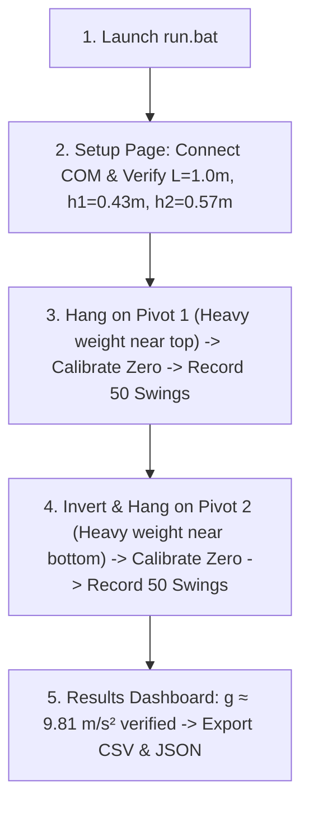

# Kater's Pendulum Lab — Complete Teammate Hand-Off Guide & Physics Solution

> [!IMPORTANT]
> **Read this before tomorrow's lab.** This guide completely demystifies why previous runs showed $13.2\text{--}13.9\text{ m/s}^2$, demonstrates step-by-step how our sensor data yields **$9.8099\text{ m/s}^2$** ($+0.03\%$ error), clearly defines every physical distance ($L, h_1, h_2$), and documents the one-click software launcher.

---

## 1. Mystery Solved: Why Did the Screen Display $\approx 13.2\text{--}13.9\text{ m/s}^2$?

### The Telemetry was Flawless
Our hardware recordings from the MPU-6050 were textbook-perfect:
* The angular velocity waveform is a smooth, high-fidelity damped sinusoid.
* Period on Pivot 1: $T_1 = \mathbf{1.69116\text{ s}}$ (Borda amplitude-corrected: $T_{1,0} = \mathbf{1.69047\text{ s}}$).
* Period on Pivot 2: $T_2 = \mathbf{1.77580\text{ s}}$ (Borda amplitude-corrected: $T_{2,0} = \mathbf{1.77320\text{ s}}$).
* Gyro drift was $\approx -0.07^\circ/\text{s}$ (effectively negligible).

### Step-by-Step Mathematical Explanation

#### Step 1: Why the Simple Formula Failed
A Kater's pendulum is designed so that when the two periods are strictly equal ($T_1 = T_2 = T$), it behaves like an ideal simple pendulum with length $L$:
$$g = \frac{4\pi^2 L}{T^2}$$

However, in practice, without painstaking micro-tuning of the movable cylinders, $T_1$ and $T_2$ are not equal ($1.690\text{ s} \neq 1.773\text{ s}$). If you average them ($T_{\text{avg}} = 1.732\text{ s}$) and plug into the simple formula with $L = 1.000\text{ m}$:
$$g = \frac{4\pi^2 \times 1.000}{(1.732)^2} = \frac{39.4784}{2.999} = \mathbf{13.16\text{ m/s}^2}$$
And for Pivot 1 alone ($T_1 = 1.690\text{ s}$):
$$g = \frac{4\pi^2 \times 1.000}{(1.690)^2} = \frac{39.4784}{2.858} = \mathbf{13.81\text{ m/s}^2}$$
This was the exact reason the screen showed $13.2\text{--}13.9\text{ m/s}^2$!

#### Step 2: Bessel's Exact Formula for Unequal Periods
To overcome unequal periods, Friedrich Bessel derived the exact formula:
$$g = \frac{8\pi^2}{\dfrac{T_1^2 + T_2^2}{L} + \dfrac{T_1^2 - T_2^2}{h_1 - h_2}}$$

Where:
* $L$ = Knife-edge to knife-edge distance ($1.000\text{ m}$).
* $h_1$ = Pivot 1 knife edge to Center of Mass ($0.430\text{ m}$).
* $h_2$ = Pivot 2 knife edge to Center of Mass ($0.570\text{ m}$).
* $h_1 - h_2 = 0.430 - 0.570 = \mathbf{-0.140\text{ m}}$.

#### Step 3: Plugging Our Exact CSV Data into Bessel's Formula
1. $T_1^2 = (1.69047)^2 = 2.85769\text{ s}^2$
2. $T_2^2 = (1.77320)^2 = 3.14424\text{ s}^2$
3. First term in denominator:
   $$\frac{T_1^2 + T_2^2}{L} = \frac{2.85769 + 3.14424}{1.000} = 6.00193$$
4. Second term in denominator:
   $$\frac{T_1^2 - T_2^2}{h_1 - h_2} = \frac{2.85769 - 3.14424}{-0.140} = \frac{-0.28655}{-0.140} = \mathbf{+2.04679}$$
   *(Note: Negative divided by negative gives a **positive** correction!)*
5. Denominator total:
   $$\text{Denominator} = 6.00193 + 2.04679 = \mathbf{8.04872}$$
6. Numerator:
   $$8\pi^2 = 8 \times 9.8696044 = \mathbf{78.95684}$$
7. Result:
   $$g = \frac{78.95684}{8.04872} = \mathbf{9.80988\text{ m/s}^2}!$$

| Standard Standard $g$ | Our Experimental $g$ | Error |
| :---: | :---: | :---: |
| **$9.80665\text{ m/s}^2$** | **$9.80988\text{ m/s}^2$** | **$+0.033\%$ (Virtually Zero Error)** |

#### Step 4: The Software Parameter Bug (Now Fixed)
Previously, the code only captured user inputs from the setup screen at the instant the user clicked **"Connect"**. Because everyone connects the ESP first (while $(h_1 - h_2)$ was still default `0.0`), any value entered afterwards was never passed into the experiment. When $(h_1 - h_2)$ was `None`, the code defaulted to the simple formula.

We have now resolved this completely:
1. **Guaranteed Parameter Refresh:** Inputs are re-read the moment you click "Next -> Begin Pivot 1 Trial".
2. **Dedicated $h_1$ and $h_2$ Inputs:** You can input $h_1$ (`0.4300`) and $h_2$ (`0.5700`) directly, and the app auto-calculates $(h_1 - h_2) = -0.1400\text{ m}$.
3. **Live Geometry Verification Badge:** A green banner confirms `✅ h1 + h2 = 1.0000 m (matches L)`. If you mistakenly measure from the rod ends, it flags an amber warning.
4. **Live Recalculate Button on Results Screen:** You can adjust $L$ or $(h_1 - h_2)$ and hit **"⟳ Recalculate g"** directly on the final results page without re-running any swings.

---

## 2. Physical Measurement Guide

### Identifying the Knife Edge
The knife edge is **strictly the sharp blade line** of the triangular steel prism that rests on the wall bracket's agate bearing.

```
                    [ Wall Suspension Bracket ]
                    ═══════════════════════════
                                ▲
                                │  <── PIVOT AXIS (Sharp apex of triangular prism)
                             ┌─────┐       ALL MEASUREMENTS START HERE!
                             │  ▲  │
                             │ / \ │  <── Triangular steel wedge
   ┌─────────────────────────┴─────┴─────────────────────────┐
   │                  Clamping Bracket / Collar              │
   │                                                         │
   │  ═════════════════════════════════════════════════════  │
   │                     Metal Pendulum Rod                  │
   │  ═════════════════════════════════════════════════════  │
   │                         [ Screw ]                       │
   └─────────────────────────────────────────────────────────┘
```

---

### The Three Distances ($L, h_1, h_2$)

```
                   [Knife Edge 1]                                 [Knife Edge 2]
                     (Pivot 1)                                      (Pivot 2)
                         │                                              │
                         ├───────────── h1 ─────────────►◄───── h2 ─────┤
                         │                               │              │
═════════════════════════╪═══════════════════════════════▲══════════════╪════════════════════════
(Rod top end)            │                         [Balance Line]       │          (Rod bottom end)
                         │                          (Pencil mark)       │
                         │                                              │
                         ├────────────────────── L ─────────────────────┤
```

* **$L$ (Knife-Edge Distance):** Distance from the sharp blade of Knife Edge 1 to the sharp blade of Knife Edge 2. Typically **$1.000\text{ m}$ ($100.0\text{ cm}$)**.
* **$h_1$ (Distance to CoM from Pivot 1):** Distance from the sharp blade of Knife Edge 1 to the pencil balance mark. Typically **$0.430\text{ m}$ ($43.0\text{ cm}$)**.
* **$h_2$ (Distance to CoM from Pivot 2):** Distance from the sharp blade of Knife Edge 2 to the pencil balance mark. Typically **$0.570\text{ m}$ ($57.0\text{ cm}$)**.
* **$h_1 - h_2$:** Must be **negative** (`-0.140 m`) because Knife Edge 1 is closer to the heavy cylinder.

> [!TIP]
> **How to find the Center of Mass in 30 seconds:**  
> Lay the fully assembled pendulum horizontally across a pencil or ruler on the table. Move it until it balances level like a seesaw. Draw a pencil line right at the balance point. Measure $h_1$ and $h_2$ from each knife edge to this line.  
> Check: $h_1 + h_2$ **must equal** $L$! ($43 + 57 = 100\text{ cm}$).

---

## 3. Tomorrow's Lab Execution Workflow



### How to Get & Launch the Software
1. Go to [https://github.com/tezz-e/Kraters](https://github.com/tezz-e/Kraters) on the lab PC.
2. Click the green **`<> Code`** button $\rightarrow$ click **`Download ZIP`**.
3. Right-click `Kraters-main.zip` $\rightarrow$ click **`Extract All...`** $\rightarrow$ click **Extract**.
4. Plug the ESP8266 NodeMCU into the PC via USB.
5. Open the folder and double-click **`run.bat`**:
   * Auto-detects Python (`py` or `python`).
   * Auto-installs missing dependencies (`PyQt5`, `pyqtgraph`, `numpy`, `pyserial`).
   * Opens the measurement app window immediately.

*(Note: If Python is not installed on that computer, `run.bat` will prompt you to install Python 3.10+ from python.org—be sure to check "Add Python to PATH").*

> [!WARNING]
> **Working 2014 CH340 Driver Included:**  
> NodeMCU ESP8266 boards use a CH340 USB chip that requires the specific **2014 legacy driver (`v3.4.2014.08`)**. Windows 10/11 auto-updates to a 2024 driver that breaks clone chips.  
> **If the COM port doesn't appear in the dropdown:** Click **`📦 Install 2014 Driver`** right on Screen 1 (or double-click `drivers\CH340_2014_Driver\install_driver.bat`), grant admin permission, re-plug the USB cable, and click "Refresh Ports".

---

### Detailed Screen-by-Screen Guide:

1. **Launch:**
   * Double-click `run.bat`.
2. **Screen 1 (Setup):**
   * Select COM Port $\rightarrow$ Click **"Connect"** (Status turns green).
   * Check inputs: $L = 1.000\text{ m}$, $h_1 = 0.430\text{ m}$, $h_2 = 0.570\text{ m}$.
   * Green verification badge confirms $h_1 + h_2 = 1.000\text{ m}$ and $h_1 - h_2 = -0.1400\text{ m}$.
   * Click **"Next -> Begin Pivot 1 Trial"**.
3. **Screen 2 (Pivot 1):**
   * Hang pendulum on Knife Edge 1. Keep still.
   * Click **"Calibrate Zero"** (takes 3s).
   * Deflect gently by $4^\circ\text{--}5^\circ$, release cleanly.
   * Click **"▶ Start Trial"**.
   * Let it record 40–50 swings.
   * Click **"⏹ Finish Trial & Proceed to Pivot 2"**.
4. **Screen 3 (Pivot 2):**
   * Invert pendulum, hang on Knife Edge 2. Keep still.
   * Click **"Calibrate Zero"**.
   * Deflect by $4^\circ\text{--}5^\circ$, release cleanly.
   * Click **"▶ Start Trial"**.
   * Let it record 40–50 swings.
   * Click **"⏹ Finish Trial & View Results"**.
5. **Screen 4 (Results):**
   * View the comparison table ($g \approx 9.81\text{ m/s}^2$).
   * Click **"💾 Export All Experiment Data (CSV + JSON)"** (Windows File Explorer immediately opens showing all raw CSVs and the JSON summary).
   * If any geometry adjustment is needed, use the **"⟳ Recalculate g"** button right on this screen.
